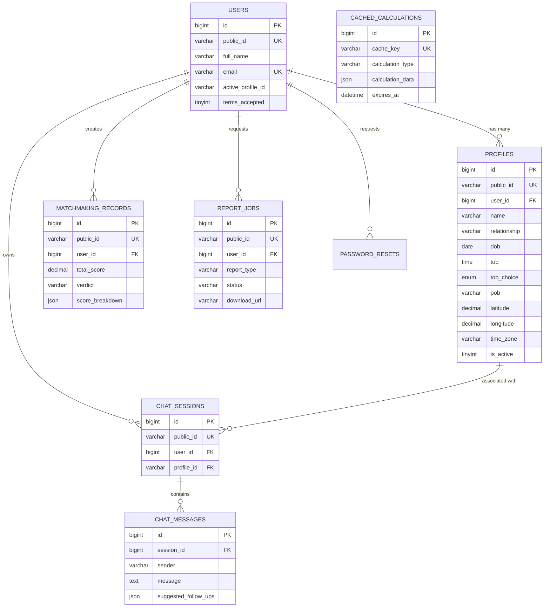
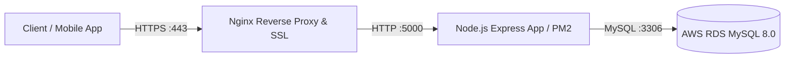

# Vidhilikhit Vedic Astrology REST API Backend

> Production-grade REST API backend for **Vidhilikhit Vedic Astrology** built with **Node.js**, **Express.js**, and **MySQL**, powered by astronomical Swiss Ephemeris calculations via `@node-jhora` (`@node-jhora/core`, `@node-jhora/analytics`, `@node-jhora/prediction`, `@node-jhora/reporting`, `@node-jhora/ephe`).

---

## 🌟 Key Features & Vedic Capabilities

- **Standard Response Envelope**: Consistent `{ success, message, data, timestamp }` across all endpoints with RFC 3339 / ISO 8601 UTC timestamps.
- **Layered Clean Architecture**: Strict decoupling across Routes $\rightarrow$ Controllers $\rightarrow$ Services $\rightarrow$ Data Access Objects (DAOs).
- **Vedic Ephemeris Calculations**: Real planetary positions (9 Grahas), Bhavas (12 Houses), Vargas (D1 Rashi, D4 Chaturthamsa, D7 Saptamsa, D9 Navamsha, D10 Dashamsha, D12 Dwadasamsa), and Yogas using `@node-jhora`.
- **Vimshottari Dasha Engine**: Accurate 120-year Nakshatra-based Mahadasha, Antardasha, and Pratyantardasha timeline calculation.
- **SVG Chart Renderer**: Real-time North and South Indian chart vector generation for client-side display.
- **Ashtakoota 36 Guna Milan**: Comprehensive matrimonial matchmaking with 8 Kootas, 7 compatibility dimensions, and Manglik Dosha evaluation.
- **Personalised Daily Guidance & Panchang**: Real-time Tithi, Nakshatra, Yoga, Karana, Rahu Kaal, auspicious Muhurats, lucky elements, and affirmations across Today, Tomorrow, This Week, and This Month.
- **Specialized Astrology Reports**: Catalog with INR pricing, asynchronous background report generation, job status tracking, and PDF download links.
- **Ask Vidhilikhit AI Astrologer Bot**: Context-aware consultation incorporating user birth chart, running Mahadasha, and planetary transits, with automated follow-up suggestions.
- **Family Profile Switcher**: Multi-profile management with active profile switching (`/profiles/:id/activate`).
- **Utility APIs**: Location autocomplete with geocoding, IANA timezone lookup, and GMT offsets.

---

## 🏗️ Directory Structure

```
VIDHILIKHIT-backend/
├── postman/
│   ├── Vidhilikhit_Vedic_API.postman_collection.json # Postman v2.1 collection (All 9 Flows)
│   └── Vidhilikhit_Vedic.postman_environment.json   # Environment (baseUrl, token, profileId)
├── src/
│   ├── config/             # MySQL pool (mysql2/promise) and environment variables
│   │   ├── db.js
│   │   └── env.js
│   ├── controllers/        # Request handling and HTTP status mapping
│   │   ├── auth.controller.js
│   │   ├── bot.controller.js
│   │   ├── dashboard.controller.js
│   │   ├── guidance.controller.js
│   │   ├── kundali.controller.js
│   │   ├── location.controller.js
│   │   ├── matchmaking.controller.js
│   │   ├── profile.controller.js
│   │   ├── report.controller.js
│   │   └── user.controller.js
│   ├── daos/               # Data Access Objects (parameterized SQL queries)
│   │   ├── bot.dao.js
│   │   ├── matchmaking.dao.js
│   │   ├── passwordReset.dao.js
│   │   ├── profile.dao.js
│   │   ├── report.dao.js
│   │   └── user.dao.js
│   ├── middlewares/        # Bearer JWT auth, Joi validator, centralized error handler
│   │   ├── auth.middleware.js
│   │   ├── errorHandler.middleware.js
│   │   └── validate.middleware.js
│   ├── migrations/         # Sequential database migration scripts
│   │   ├── 001_initial_schema.sql
│   │   └── 002_vidhilikhit_vedic_schema.sql
│   ├── routes/             # Express routers mounted under /api/v1
│   │   ├── auth.routes.js
│   │   ├── bot.routes.js
│   │   ├── dashboard.routes.js
│   │   ├── guidance.routes.js
│   │   ├── index.js
│   │   ├── kundali.routes.js
│   │   ├── location.routes.js
│   │   ├── matchmaking.routes.js
│   │   ├── profile.routes.js
│   │   ├── report.routes.js
│   │   └── user.routes.js
│   ├── scripts/            # CLI utilities (migrations, Postman generator)
│   │   ├── generate_postman.js
│   │   └── migrate.js
│   ├── services/           # Business logic & Vedic calculations
│   │   ├── astrology.service.js
│   │   ├── auth.service.js
│   │   ├── bot.service.js
│   │   ├── dashboard.service.js
│   │   ├── email.service.js
│   │   ├── location.service.js
│   │   ├── profile.service.js
│   │   ├── report.service.js
│   │   └── user.service.js
│   ├── utils/              # Envelope formatters and cryptographic JWT tokens
│   │   ├── response.js
│   │   └── token.js
│   ├── validations/        # Joi schema validations
│   │   ├── auth.validation.js
│   │   ├── matchmaking.validation.js
│   │   ├── profile.validation.js
│   │   └── user.validation.js
│   └── app.js              # Express application configuration
├── tests/
│   ├── api.test.js         # Base auth & profile integration tests (20/20 passing)
│   └── vedic_api.test.js   # Specification test suite for all 9 flows (23/23 passing)
├── .env.example
├── package.json
├── README.md
└── server.js               # HTTP server entrypoint
```

---

## 🗄️ MySQL Database Schema

The database design uses strict ACID transactions, indexed foreign keys with cascading deletions, and human-readable prefixed UUIDs (`usr_...`, `prof_...`, `match_...`, `job_...`, `sess_...`).

### Key Tables & Relationships



---

## 🚀 Local Development Setup

### 1. Prerequisites
- **Node.js**: v18.0.0 or higher
- **MySQL**: v8.0 or higher running on port 3306
- **npm**: v9.0.0 or higher

### 2. Installation
```bash
git clone https://github.com/your-org/VIDHILIKHIT-backend.git
cd VIDHILIKHIT-backend
npm install
```

### 3. Environment Setup
Copy `.env.example` to `.env` and fill in your credentials:
```bash
cp .env.example .env
```

Verify your local `.env`:
```env
PORT=5000
NODE_ENV=development
DB_HOST=localhost
DB_PORT=3306
DB_USER=root
DB_PASSWORD=your_mysql_password
DB_NAME=vidhilikhit_db
JWT_SECRET=super_secret_jwt_key_vidhilikhit_2026_change_in_production
JWT_EXPIRES_IN=24h
```

### 4. Run Migrations
Run the automated migration runner to create tables and seed initial schema:
```bash
npm run migrate
```

### 5. Run Integration Tests
Execute the full automated test suite (43 integration tests):
```bash
npm test
```

To run individual test suites:
```bash
node --test tests/vedic_api.test.js
node --test tests/api.test.js
```

### 6. Start the API Server
Development mode with live reload:
```bash
npm run dev
```
Standard production run:
```bash
npm start
```
The server will start listening at `http://localhost:5000/api/v1`.

---

## 📡 Complete API Reference (All 9 Flows)

All endpoints accept and return JSON with the standard envelope:
```json
{
  "success": true,
  "message": "Operation description",
  "data": { ... },
  "timestamp": "2026-11-03T16:20:00.000Z"
}
```

### Flow 1: Authentication & User Setup
| Method | Path | Description | Auth Required |
|---|---|---|---|
| `POST` | `/api/v1/auth/register` | Register user and provision birth profile | No |
| `POST` | `/api/v1/auth/login` | Authenticate user; returns `tokens: { accessToken, refreshToken }` | No |
| `POST` | `/api/v1/auth/forgot-password` | Request password reset token via email | No |
| `POST` | `/api/v1/auth/reset-password` | Reset password with token | No |
| `GET` | `/api/v1/auth/me` | Fetch authenticated user information | Yes |

### Flow 2: Multiple Profiles & Family Switcher
| Method | Path | Description | Auth Required |
|---|---|---|---|
| `GET` | `/api/v1/profiles` | List all profiles with `activeProfileId` | Yes |
| `POST` | `/api/v1/profiles` | Add family profile (`spouse`, `child`, `parent`, etc.) | Yes |
| `POST` | `/api/v1/profiles/:id/activate` | Switch active profile for calculation context | Yes |
| `PUT` | `/api/v1/profiles/:id` | Update profile birth details | Yes |
| `DELETE`| `/api/v1/profiles/:id` | Remove profile | Yes |

### Flow 3: Home Dashboard & Notifications
| Method | Path | Description | Auth Required |
|---|---|---|---|
| `GET` | `/api/v1/home/dashboard` | Returns active Mahadasha, daily horoscope, panchang snippet, quick actions | Yes |

### Flow 4: My Kundali (Calculations & Charts)
| Method | Path | Description | Auth Required |
|---|---|---|---|
| `GET` | `/api/v1/kundali/overview` | Lagna, Moon sign, Nakshatra, 12 house placements, SVG chart URL | Yes |
| `GET` | `/api/v1/kundali/grahas` | 9 Grahas positions, retrograde, combustion, dignities | Yes |
| `GET` | `/api/v1/kundali/bhavas` | 12 Bhavas houses, house lords, occupants, and aspects | Yes |
| `GET` | `/api/v1/kundali/vargas` | Divisional charts list D1, D4, D7, D9, D10, D12 | Yes |
| `GET` | `/api/v1/kundali/yogas` | Detected classical Vedic yogas with descriptions | Yes |
| `GET` | `/api/v1/kundali/dasha` | Exact 120-year Vimshottari Mahadasha timeline | Yes |
| `GET` | `/api/v1/kundali/chart-render/:varga` | Standalone SVG vector chart render (`chartStyle=north\|south`) | Yes |

### Flow 5: Matchmaking & Kundali Milan
| Method | Path | Description | Auth Required |
|---|---|---|---|
| `POST` | `/api/v1/matchmaking/calculate` | Calculates Ashtakoota 36 Gunas, Manglik analysis, 7 dimensions | Yes |
| `GET` | `/api/v1/matchmaking/:matchId/details` | Detailed breakdown of all 8 Kootas and 7 dimensions | Yes |

### Flow 6: Daily Guidance & Panchang
| Method | Path | Description | Auth Required |
|---|---|---|---|
| `GET` | `/api/v1/guidance/forecast` | Personalised guidance (`timeframe=today\|tomorrow\|this_week\|this_month`) | Yes |

### Flow 7: Specialized Astrology Reports
| Method | Path | Description | Auth Required |
|---|---|---|---|
| `GET` | `/api/v1/reports/catalog` | Report catalog with titles, pages, and INR pricing | Yes |
| `POST` | `/api/v1/reports/generate` | Asynchronously queues report generation, returns `reportJobId` | Yes |
| `GET` | `/api/v1/reports/status/:reportJobId` | Check job status (`processing`, `completed`) and download URL | Yes |

### Flow 8: Ask Vidhilikhit AI Vedic Consultation Bot
| Method | Path | Description | Auth Required |
|---|---|---|---|
| `GET` | `/api/v1/bot/chat/history` | Retrieves active chat session and conversation messages | Yes |
| `POST` | `/api/v1/bot/chat/send` | Chat with Vedic AI consultant with birth chart and dasha context | Yes |

### Flow 9: Utility APIs (Locations)
| Method | Path | Description | Auth Required |
|---|---|---|---|
| `GET` | `/api/v1/locations/autocomplete` | Location autocomplete with coordinates, timezone & GMT offset | No |

---

## 📮 Postman Collection Setup

1. Open Postman $\rightarrow$ Click **Import**.
2. Select:
   - `postman/Vidhilikhit_Vedic_API.postman_collection.json`
   - `postman/Vidhilikhit_Vedic.postman_environment.json`
3. Select **Vidhilikhit Vedic Astrology - Local** environment from the dropdown.
4. Execute `Flow 1 -> 1.2 Login User`:
   - The test script extracts `res.data.tokens.accessToken` and stores it automatically in the `{{token}}` variable.
   - All subsequent authenticated requests automatically carry `Authorization: Bearer {{token}}`.

---

## ☁️ Step-by-Step AWS Production Deployment Guide

This guide covers deploying the Vidhilikhit REST API on **AWS EC2** (Ubuntu 22.04 / 24.04 LTS) with **Nginx** as reverse proxy, **PM2** process supervisor, **AWS RDS MySQL**, and **Let's Encrypt SSL**.



### 1. VPC & Security Groups Configuration

Configure two Security Groups in your AWS VPC:

#### A. EC2 Security Group (`vidhilikhit-ec2-sg`)
- **Inbound Rules**:
  - `SSH` (Port 22): Source `Your_Admin_IP/32`
  - `HTTP` (Port 80): Source `0.0.0.0/0` (Used for Certbot HTTP challenge)
  - `HTTPS` (Port 443): Source `0.0.0.0/0`
- **Outbound Rules**:
  - All traffic to `0.0.0.0/0`

#### B. RDS Security Group (`vidhilikhit-rds-sg`)
- **Inbound Rules**:
  - `MySQL/Aurora` (Port 3306): Source `vidhilikhit-ec2-sg` (Security Group reference—**never open 3306 to 0.0.0.0/0**)
- **Outbound Rules**:
  - All traffic to `0.0.0.0/0`

---

### 2. AWS RDS MySQL Database Setup

1. In the AWS Console, navigate to **RDS** $\rightarrow$ **Databases** $\rightarrow$ **Create database**.
2. Settings:
   - Engine: **MySQL Community** (version 8.0.35+)
   - Template: **Production** or **Free Tier**
   - DB instance identifier: `vidhilikhit-mysql-prod`
   - Master username: `admin`
   - Master password: `<GenerateStrongPassword>`
   - Instance class: `db.t4g.micro` or `db.t4g.small`
   - Connectivity:
     - VPC: Same VPC as your EC2 instance
     - Public access: **No**
     - Existing VPC security groups: select `vidhilikhit-rds-sg`
   - Additional configuration:
     - Initial database name: `vidhilikhit_db`
     - Automatic backups: Enabled (7 days retention)
3. Note down the **RDS Endpoint** (e.g. `vidhilikhit-mysql-prod.c123456789.ap-southeast-2.rds.amazonaws.com`).

---

### 3. Launch & Prepare the EC2 Instance

1. Launch an **Ubuntu 22.04 LTS** or **24.04 LTS** instance (`t3.small` or `t4g.small` recommended).
2. Attach `vidhilikhit-ec2-sg`.
3. Connect via SSH:
   ```bash
   ssh -i your-key.pem ubuntu@your-ec2-public-ip
   ```
4. Update packages and install prerequisites:
   ```bash
   sudo apt update && sudo apt upgrade -y
   sudo apt install -y curl git build-essential nginx certbot python3-certbot-nginx
   ```
5. Install **Node.js 22 LTS**:
   ```bash
   curl -fsSL https://deb.nodesource.com/setup_22.x | sudo -E bash -
   sudo apt install -y nodejs
   node -v # Verify v22.x
   npm -v
   ```
6. Install **PM2** globally:
   ```bash
   sudo npm install -g pm2
   ```

---

### 4. Deploy Application Code & Configure Environment

1. Clone your repository into `/var/www/vidhilikhit`:
   ```bash
   sudo mkdir -p /var/www/vidhilikhit
   sudo chown -R ubuntu:ubuntu /var/www/vidhilikhit
   cd /var/www/vidhilikhit
   git clone https://github.com/your-org/VIDHILIKHIT-backend.git .
   ```
2. Install production dependencies:
   ```bash
   npm ci --production=false
   ```
3. Create production `.env`:
   ```bash
   nano .env
   ```
   Add your production configuration:
   ```env
   PORT=5000
   NODE_ENV=production

   # AWS RDS MySQL Credentials
   DB_HOST=vidhilikhit-mysql-prod.c123456789.ap-southeast-2.rds.amazonaws.com
   DB_PORT=3306
   DB_USER=admin
   DB_PASSWORD=YourStrongRdsPassword
   DB_NAME=vidhilikhit_db

   # Cryptographic Secrets
   JWT_SECRET=super_strong_random_jwt_key_64_characters_hex_format
   JWT_EXPIRES_IN=24h
   REFRESH_TOKEN_EXPIRES_IN=7d

   # Frontend Application URL
   APP_FRONTEND_URL=https://app.vidhilikhit.com
   PASSWORD_RESET_TOKEN_EXPIRES_MINUTES=60
   ```
4. Run migrations to provision RDS tables:
   ```bash
   npm run migrate
   ```
   Verify all tables are created.

---

### 5. PM2 Process Management

1. Start the application with PM2:
   ```bash
   pm2 start server.js --name "vidhilikhit-api" -i max
   ```
2. Configure PM2 to restart automatically on system reboot:
   ```bash
   pm2 startup systemd
   # Execute the command that pm2 outputs, for example:
   # sudo env PATH=$PATH:/usr/bin /usr/lib/node_modules/pm2/bin/pm2 startup systemd -u ubuntu --hp /home/ubuntu
   pm2 save
   ```
3. Useful PM2 monitoring commands:
   ```bash
   pm2 status
   pm2 logs vidhilikhit-api
   pm2 restart vidhilikhit-api
   ```

---

### 6. Nginx Reverse Proxy Configuration

1. Create Nginx site configuration:
   ```bash
   sudo nano /etc/nginx/sites-available/vidhilikhit.conf
   ```
2. Add the configuration:
   ```nginx
   server {
       listen 80;
       server_name api.vidhilikhit.com;

       # Security Headers
       add_header X-Frame-Options "DENY" always;
       add_header X-Content-Type-Options "nosniff" always;
       add_header X-XSS-Protection "1; mode=block" always;
       add_header Referrer-Policy "strict-origin-when-cross-origin" always;

       # Gzip compression
       gzip on;
       gzip_comp_level 5;
       gzip_min_length 256;
       gzip_types application/json text/plain text/css text/javascript application/javascript image/svg+xml;

       client_max_body_size 10M;

       location / {
           proxy_pass http://127.0.0.1:5000;
           proxy_http_version 1.1;
           proxy_set_header Upgrade $http_upgrade;
           proxy_set_header Connection 'upgrade';
           proxy_set_header Host $host;
           proxy_set_header X-Real-IP $remote_addr;
           proxy_set_header X-Forwarded-For $proxy_add_x_forwarded_for;
           proxy_set_header X-Forwarded-Proto $scheme;
           proxy_cache_bypass $http_upgrade;
           proxy_connect_timeout 60s;
           proxy_send_timeout 60s;
           proxy_read_timeout 60s;
       }
   }
   ```
3. Enable site and test configuration:
   ```bash
   sudo ln -s /etc/nginx/sites-available/vidhilikhit.conf /etc/nginx/sites-enabled/
   sudo rm -f /etc/nginx/sites-enabled/default
   sudo nginx -t
   sudo systemctl restart nginx
   ```

---

### 7. SSL Certificate with Let's Encrypt (Certbot)

1. Ensure your domain's DNS `A` record (`api.vidhilikhit.com`) points to your EC2 public IP.
2. Obtain and install SSL certificate:
   ```bash
   sudo certbot --nginx -d api.vidhilikhit.com --non-interactive --agree-tos -m devops@vidhilikhit.com
   ```
3. Certbot will automatically reconfigure Nginx for HTTPS (:443) and set up HTTP $\rightarrow$ HTTPS 301 redirects.
4. Verify automatic certificate renewal:
   ```bash
   sudo certbot renew --dry-run
   ```

---

### 8. Verification & Health Check

Test the live production deployment from your terminal:
```bash
curl -i https://api.vidhilikhit.com/api/v1/locations/autocomplete?query=Mumbai
```

Expected response:
```json
{
  "success": true,
  "message": "Locations retrieved successfully",
  "data": [
    {
      "address": "Mumbai, Maharashtra, India",
      "latitude": 19.076,
      "longitude": 72.8777,
      "timezone": "Asia/Kolkata",
      "gmtOffset": "+05:30"
    }
  ],
  "timestamp": "2026-11-03T16:20:00.000Z"
}
```

---

## 🛡️ License

Proprietary — All Rights Reserved © Vidhilikhit 2026.
